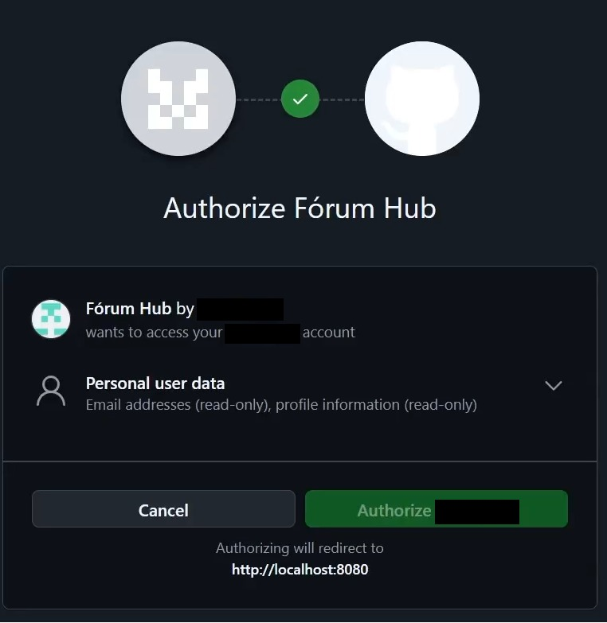

# 🔐 Forum Hub — API REST com Spring Security

O **Forum Hub** é uma API REST desenvolvida com **Java e Spring Boot** para gerenciamento de tópicos de um fórum fictício.

O projeto foi desenvolvido durante meus estudos em dois cursos da **Alura**, explorando mecanismos de autenticação, autorização e segurança de aplicações Backend com Spring Security.

## 🚀 Tecnologias utilizadas

- **Backend:** Java, Spring Boot e Spring Data JPA
- **Segurança:** Spring Security, JWT, OAuth 2.0, OpenID Connect (OIDC) e 2FA/TOTP
- **Banco de dados:** MySQL
- **Integrações:** RestClient e SMTP
- **Ferramentas:** Maven e Postman

## 🔑 Funcionalidades e conceitos abordados

### Autenticação e autorização

- Cadastro e gerenciamento de usuários.
- Armazenamento de senhas com hash.
- Autenticação Stateless com JWT.
- Access Token e Refresh Token.
- Filtros de autenticação e validação de tokens.
- Controle de acesso por perfis, permissões e hierarquia de papéis.

### Integrações e segurança

- Fluxos de autenticação externa com GitHub e Google utilizando OAuth 2.0.
- Utilização de OpenID Connect (OIDC).
- Comunicação com serviços externos utilizando RestClient.
- Verificação de e-mail.
- Autenticação de dois fatores (2FA) com TOTP.
- Geração de QR Code e validação de códigos temporários.

> **Nota:** algumas integrações externas dependem de credenciais e configurações adicionais. Os fluxos ainda não foram integralmente testados em ambiente de execução.

## 🎥 Demonstração e capturas do projeto

### Visão geral

O GIF apresenta a estrutura do projeto e trechos das implementações de autenticação e segurança.


### Requisição HTTP com Postman

Exemplo de requisição `POST /topicos` com dados enviados em formato JSON.


### Autorização OAuth 2.0 com GitHub

Tela de solicitação de autorização do aplicativo Fórum Hub no GitHub, ilustrando uma etapa do fluxo OAuth 2.0.



## ⚙️ Configuração do projeto

O projeto utiliza MySQL para persistência de dados, SMTP para envio de e-mails e configurações OAuth 2.0 para integração com GitHub e Google.

### Pré-requisitos

- JDK compatível com a versão definida no `pom.xml`.
- MySQL.
- Maven ou Maven Wrapper.
- Credenciais dos serviços externos, quando necessárias.

### Variáveis de ambiente

| Variável | Finalidade |
|---|---|
| `DB_USERNAME` | Usuário do MySQL |
| `DB_PASSWORD` | Senha do MySQL |
| `EMAIL_USERNAME` | Conta utilizada no serviço SMTP |
| `EMAIL_PASSWORD` | Credencial de autenticação SMTP |
| `GITHUB_CLIENT_ID` | Identificador do cliente OAuth do GitHub |
| `GITHUB_CLIENT_SECRET` | Segredo do cliente OAuth do GitHub |
| `GOOGLE_CLIENT_ID` | Identificador do cliente OAuth do Google |
| `GOOGLE_CLIENT_SECRET` | Segredo do cliente OAuth do Google |

Exemplo recomendado de configuração no `application.properties`:

```properties
spring.datasource.url=jdbc:mysql://localhost/forum_hub?createDatabaseIfNotExist=true
spring.datasource.username=${DB_USERNAME}
spring.datasource.password=${DB_PASSWORD}

spring.mail.host=smtp.gmail.com
spring.mail.port=587
spring.mail.username=${EMAIL_USERNAME}
spring.mail.password=${EMAIL_PASSWORD}
spring.mail.properties.mail.smtp.auth=true
spring.mail.properties.mail.smtp.starttls.enable=true

github.oauth.client.id=${GITHUB_CLIENT_ID}
github.oauth.client.secret=${GITHUB_CLIENT_SECRET}

google.oauth.client.id=${GOOGLE_CLIENT_ID}
google.oauth.client.secret=${GOOGLE_CLIENT_SECRET}
```

> **Importante:** este é um exemplo de configuração recomendada. O arquivo `application.properties` do projeto deve ser ajustado para utilizar essas variáveis. As integrações OAuth e SMTP também exigem configuração nos respectivos serviços.

**Segurança:** não publique senhas, tokens ou Client Secrets no repositório.

## 📚 Cursos utilizados como base

Projeto desenvolvido durante os estudos dos cursos da **Alura**:

- **Java e Spring Security: Proteja suas APIs REST.**
- **Java e Spring Security: Login com GitHub, Google e autenticação de 2 fatores.**

## 📌 Status

🚧 **Projeto de estudos em desenvolvimento e documentação.**

Este repositório registra minha prática com Java Backend e mecanismos de segurança utilizando Spring Security.
