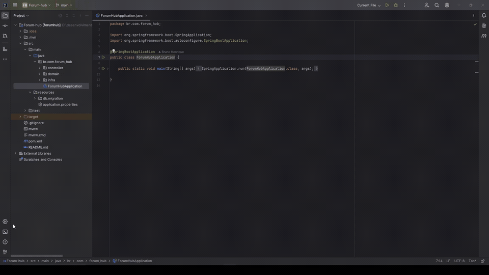
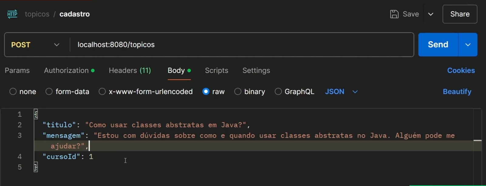

# 🔐 Forum Hub — API REST com Spring Security

O projeto **Forum Hub** é uma API REST desenvolvida com **Java e Spring Boot** para o gerenciamento de tópicos de um fórum fictício de tecnologia.

O Forum Hub foi desenvolvido durante dois cursos da plataforma **Alura**, com foco principal na implementação de mecanismos de autenticação, autorização e segurança de aplicações Backend utilizando Spring Security.

## 🚀 Tecnologias utilizadas

- **Backend:** Java, Spring Boot e Spring Data JPA
- **Segurança:** Spring Security, OAuth 2.0, JWT, OpenID Connect (OIDC) e 2FA/TOTP
- **Banco de dados:** MySQL
- **Integrações:** RestClient e SMTP
- **Ferramentas:** Maven e Postman

## 😎 Funcionalidades e conceitos abordados no projeto

### Autenticação e autorização

- Cadastro e gerenciamento de usuários
- Armazenamento de senhas com hash
- Autenticação Stateless com JWT
- Access Token e Refresh Token
- Filtros de autenticação e validação de tokens JWT
- Controle de acesso por perfis, permissões e hierarquia de papéis de cada usuário

### Integrações e segurança no Forum Hub

- Implementação de fluxos de autenticação externa com GitHub e Google utilizando OAuth 2.0
- Utilização do protocolo OpenID Connect (OIDC)
- Comunicação com serviços externos utilizando RestClient
- Verificação de e-mail do usuário
- Autenticação de dois fatores (2FA) com TOTP
- Geração de QR Code e validação de códigos temporários para acesso

> **Observação:** As integrações com os serviços externos, como o Google e Github, possuem configurações que podem variar conforme o ambiente em que se está executando

## 🎥 Demonstração e capturas do projeto

### Visão geral

O GIF abaixo apresenta a estrutura do projeto e alguns trechos das implementações de autenticação e segurança



### Requisição HTTP com a ferramenta Postman

Exemplo de uma requisição `POST /topicos` com dados enviados em formato JSON no postman



## ⚙️ Configuração do projeto

O Forum Hub utiliza o banco de dados MySQL para persistência de dados, SMTP para envio de e-mails e OAuth 2.0 para integração com GitHub e Google.

As credenciais são fornecidas por **variáveis de ambiente**, evitando a exposição de dados sensíveis diretamente no código fonte.

### Pré-requisitos

- JDK compatível com a versão definida no `pom.xml`.
- MySQL.
- Maven ou Maven Wrapper.
- Credenciais dos serviços externos, quando necessárias.

### Variáveis de ambiente que você precisa preencher para rodar o Forum Hub

| Variável | Finalidade                               |
|---|------------------------------------------|
| `DB_USERNAME` | Usuário do MySQL                         |
| `DB_PASSWORD` | Senha do banco                           |
| `EMAIL_USERNAME` | Conta utilizada no serviço SMTP          |
| `EMAIL_PASSWORD` | Credencial de autenticação SMTP          |
| `GITHUB_CLIENT_ID` | Identificador do cliente OAuth do GitHub |
| `GITHUB_CLIENT_SECRET` | Token do cliente OAuth do GitHub         |
| `GOOGLE_CLIENT_ID` | Identificador do cliente OAuth do Google |
| `GOOGLE_CLIENT_SECRET` | Token do cliente OAuth do Google         |

### Configuração do `application.properties`

```properties
spring.application.name=forum_hub

spring.datasource.url=jdbc:mysql://localhost/forum_hub?createDatabaseIfNotExist=true
spring.datasource.username=${DB_USERNAME}
spring.datasource.password=${DB_PASSWORD}

spring.mail.host=smtp.gmail.com
spring.mail.port=587
spring.mail.username=${EMAIL_USERNAME}
spring.mail.password=${EMAIL_PASSWORD}
spring.mail.properties.mail.smtp.auth=true
spring.mail.properties.mail.smtp.starttls.enable=true

github.oauth.client.id=${GITHUB_CLIENT_ID}
github.oauth.client.secret=${GITHUB_CLIENT_SECRET}

google.oauth.client.id=${GOOGLE_CLIENT_ID}
google.oauth.client.secret=${GOOGLE_CLIENT_SECRET}
```

> **Importante:** as variáveis de ambiente devem estar configuradas antes de rodar o projeto

**Segurança:** senhas, tokens e Client Secrets não devem ser publicados no repositório, por questões de segurança

## 📚 Cursos utilizados como base

Projeto desenvolvido durante os estudos dos cursos da plataforma **Alura**:

- **Java e Spring Security: Proteja suas APIs REST.**
- **Java e Spring Security: Login com GitHub, Google e autenticação de 2 fatores.**